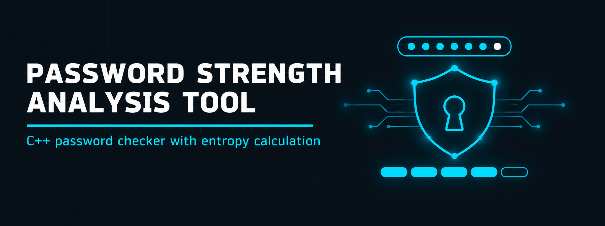
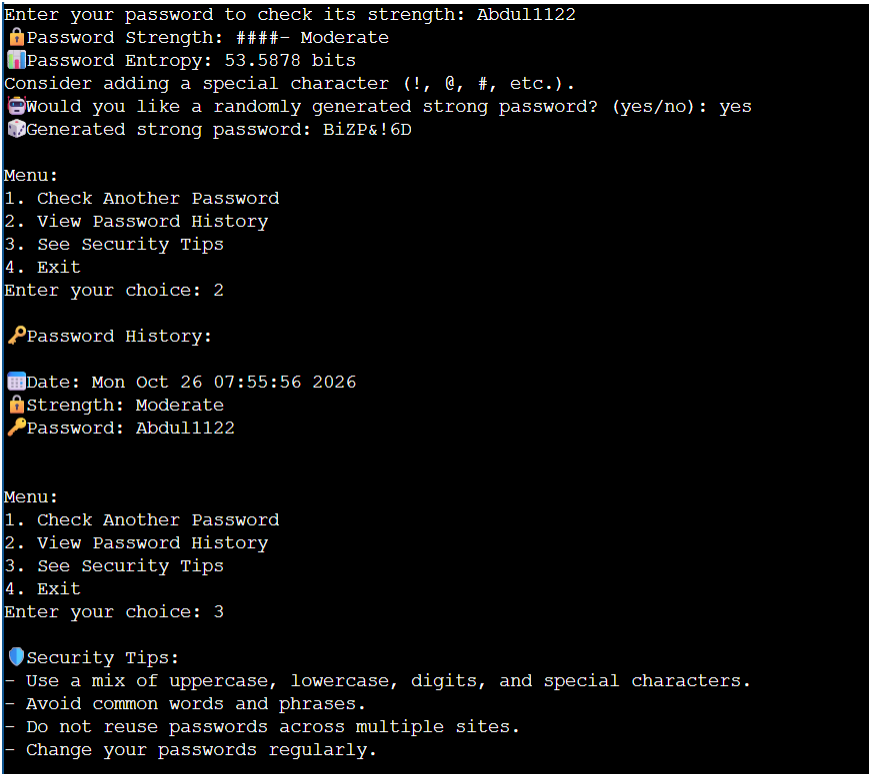
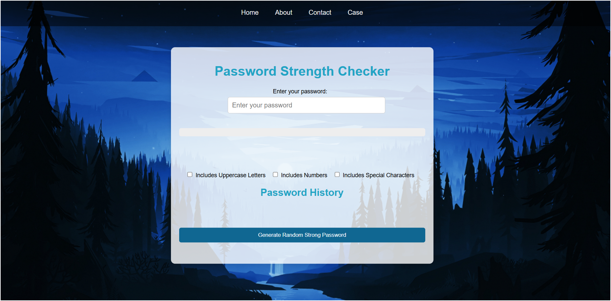
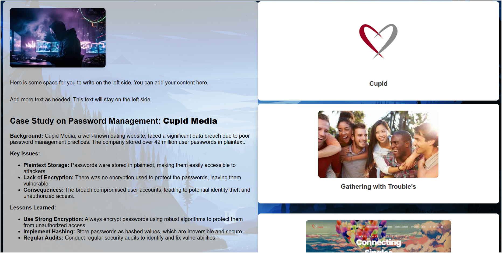
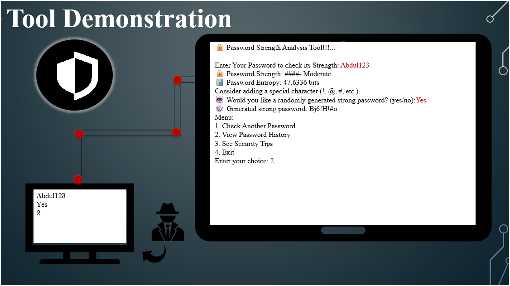

<p align="center">
  
</p>

<h1 align="center">Password Strength Analysis Tool</h1>

<h3 align="center">C++ password checker with entropy calculation, generator and security tips</h3>

<p align="center">
  
  
  
  
</p>

<p align="center">
  <a href="#overview"><b>Overview</b></a> ·
  <a href="#features"><b>Features</b></a> ·
  <a href="#screenshots"><b>Screenshots</b></a> ·
  <a href="#build--run"><b>Build</b></a> ·
  <a href="#repository-structure"><b>Structure</b></a> ·
  <a href="#future-work"><b>Future Work</b></a>
</p>

---

## Overview

A cybersecurity project that checks how strong a password is. The C++ console tool rates a password, calculates its entropy in bits, suggests improvements, generates a strong random password on request and keeps a history of checks. A browser-based version and a case study on the Cupid Media breach, where millions of passwords were stored in plaintext, are included.

| | |
| --- | --- |
| **Language** | C++ (console tool) |
| **Web version** | Browser-based checker in `Password Strength Checker/` |
| **Analysis** | Strength rating and entropy in bits |
| **Case study** | Cupid Media plaintext password breach |
| **Documents** | Project document (`.docx`) and presentation (`.pptx`) |

## Features

| Console tool | Web version |
| ------------ | ----------- |
| Strength rating for a password | Strength bar |
| Entropy calculation in bits | Uppercase, numbers and special character options |
| Suggestions to improve a password | Password history |
| Random strong password on request | Random strong password button |
| Password history with date and strength | Case study page on Cupid Media |
| Security tips | |

The password history shows checked passwords in plain text. This is a learning project and is not meant for real passwords.

## Screenshots

| | |
| --- | --- |
|  |  |
| <sub>Console tool: strength, entropy, history and tips</sub> | <sub>Web version: password strength checker</sub> |
|  |  |
| <sub>Case study: Cupid Media password breach</sub> | <sub>Presentation: tool demonstration</sub> |

## Build & Run

The C++ source is saved as a text file. Copy it to a `.cpp` file, then compile and run:

```bash
git clone https://github.com/abdul-wahid022/cpp-password-strength-analyzer.git
cd cpp-password-strength-analyzer
cp "Password Strength Analysis Tool ( C++ Code ).txt" password_tool.cpp
g++ password_tool.cpp -o password_tool
./password_tool
```

On Windows with MinGW, run `password_tool.exe` instead.

For the web version, open the HTML file inside `Password Strength Checker/` in a browser.

## Repository Structure

```
cpp-password-strength-analyzer/
├── README.md
├── Password Strength Analysis Tool ( C++ Code ).txt   # console tool source
├── Password Strength Checker/                         # web version
├── Password Strength Analysis Tool.docx               # project document
├── Password Strength Analysis Tool.pptx               # presentation
├── screenshots/                                       # tool and web screenshots
└── images/                                            # banner
```

## Future Work

- Qt graphical interface
- Breach detection through an external API
- Multi-threading for faster analysis
- Encryption for stored password history

## License

Shared for educational reference.

## Contact

<p align="center">
  <b>Abdul Wahid</b>
</p>

<p align="center">
  <a href="mailto:a.wahid7860668@gmail.com"></a>
  <a href="https://www.linkedin.com/in/abdul-wahid022"></a>
  <a href="https://github.com/abdul-wahid022"></a>
</p>
